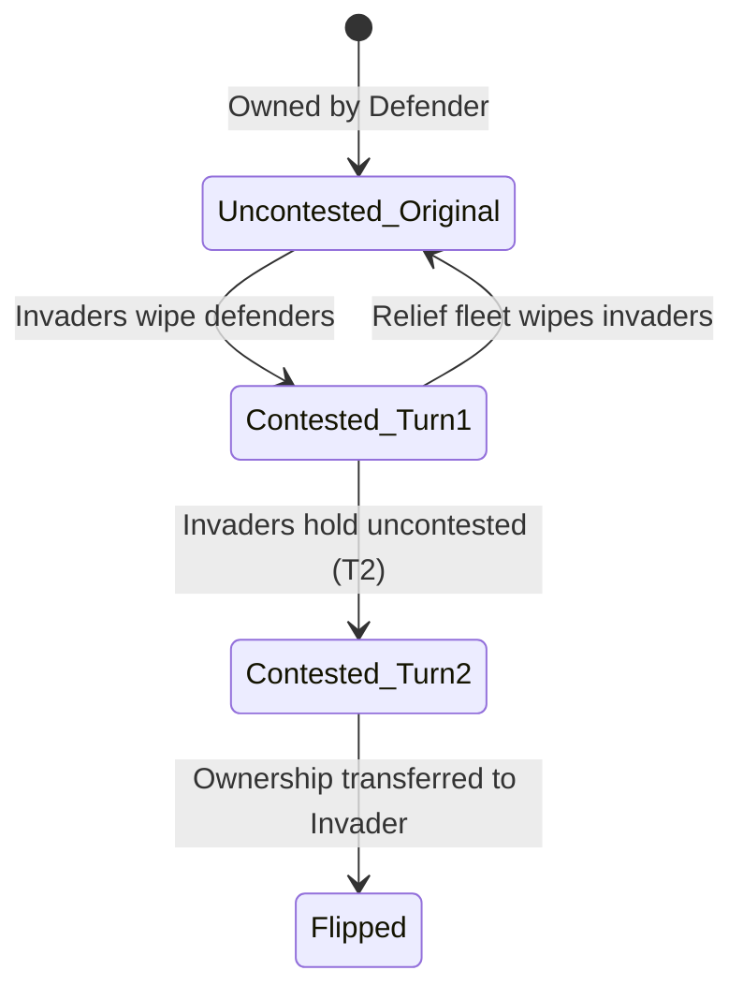
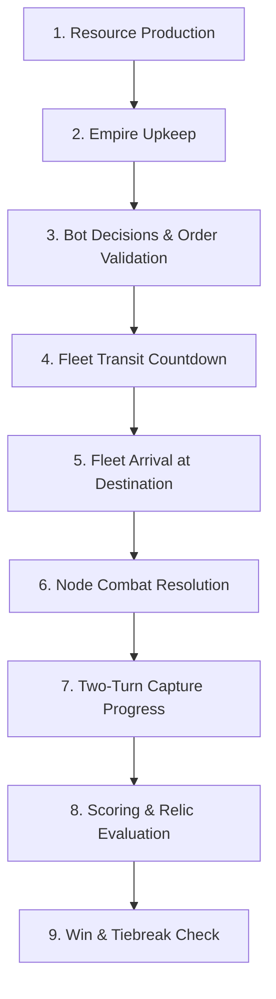

# Node War // Official Game Specification & Architecture Manual

This document provides the definitive technical specification, game rules, combat models, observation schemas, simulation lifecycle, and bot development guidelines for **Node War**.

---

## Table of Contents
1. [Game Overview & Competitive Premise](#1-game-overview--competitive-premise)
2. [Map Topology & Arena Layout](#2-map-topology--arena-layout)
3. [Economy, Production & Empire Upkeep](#3-economy-production--empire-upkeep)
4. [Units & Rock-Paper-Scissors Combat Model](#4-units--rock-paper-scissors-combat-model)
5. [Fleet Movement & The Fog-of-War System](#5-fleet-movement--the-fog-of-war-system)
6. [Node Occupation & The 2-Turn Flip Mechanic](#6-node-occupation--the-2-turn-flip-mechanic)
7. [The Central Relic & Endgame Scoring](#7-the-central-relic--endgame-scoring)
8. [The Bot Execution Model & API](#8-the-bot-execution-model--api)
9. [Detailed Observation Schema (`BotObservation`)](#9-detailed-observation-schema-botobservation)
10. [Order Submission & Validation](#10-order-submission--validation)
11. [Turn Lifecycle & Step Execution Pipeline](#11-turn-lifecycle--step-execution-pipeline)
12. [Spectator View vs Bot View](#12-spectator-view-vs-bot-view)
13. [How to Build, Test & Benchmark Bots](#13-how-to-build-test--benchmark-bots)

---

## 1. Game Overview & Competitive Premise

**Node War** is a deterministic, turn-based competitive strategy game fought between two autonomous AI agents on a symmetric graph of 15 nodes.

Each team scripts a Python bot that controls an empire. The objective is to out-produce, out-maneuver, and out-fight the opponent through superior reconnaissance, rock-paper-scissors unit composition, supply line coordination, and timing attacks on the late-game **Relic Sanctuary**.

Matches last up to **120 turns**. There are **no draws**; an exact composite tiebreak formula guarantees a deterministic winner.

---

## 2. Map Topology & Arena Layout

The battlefield consists of **15 discrete nodes** connected by travel lanes. The map is bilaterally symmetrical across the horizontal axis $X = 50.0$.

```
 [Node 4: North Rig] ---------------------------------- [Node 10: Apex Rig]
       |     \                                                /     |
       |      \                                              /      |
 [Node 1: Alpha Bastion] --- [Node 5: North Outpost] -- [Node 9: Zenith] --- [Node 13: Epsilon]
    /     \                      /            \                      /     \
   /       \                    /              \                    /       \
[P1 Core: 0] --- [Node 3: Vanguard] ----- [Node 7: Relic] ----- [Node 11: Sentinel] --- [P2 Core: 14]
   \       /                    \              /                    \       /
    \     /                      \            /                      \     /
 [Node 2: Gamma Bastion] --- [Node 6: South Outpost] -- [Node 8: Titan] --- [Node 12: Omega]
```

### Complete Node Directory
| ID | Node Name | Position $(X, Y)$ | Default Owner | Production (Credits/T) | Initial Garrison |
|:--:|:---|:---:|:---:|:---:|:---|
| **0** | **Player 1 Core** | $(10.0, 50.0)$ | Player 1 | **15** | 1 Raider, 1 Guard, 1 Scout |
| **1** | Alpha Bastion | $(25.0, 25.0)$ | Neutral | **6** | None |
| **2** | Gamma Bastion | $(25.0, 75.0)$ | Neutral | **6** | None |
| **3** | Vanguard Gate | $(32.0, 50.0)$ | Neutral | **8** | None |
| **4** | North Rig | $(40.0, 15.0)$ | Neutral | **5** | None |
| **5** | North Outpost | $(45.0, 35.0)$ | Neutral | **7** | None |
| **6** | South Outpost | $(45.0, 65.0)$ | Neutral | **7** | None |
| **7** | **Relic Sanctuary** | $(50.0, 50.0)$ | Neutral | **4** | None (Activates T95) |
| **8** | Titan Outpost | $(55.0, 65.0)$ | Neutral | **7** | None (Mirrors Node 6) |
| **9** | Zenith Outpost | $(55.0, 35.0)$ | Neutral | **7** | None (Mirrors Node 5) |
| **10** | Apex Rig | $(60.0, 15.0)$ | Neutral | **5** | None (Mirrors Node 4) |
| **11** | Sentinel Gate | $(68.0, 50.0)$ | Neutral | **8** | None (Mirrors Node 3) |
| **12** | Omega Bastion | $(75.0, 75.0)$ | Neutral | **6** | None (Mirrors Node 2) |
| **13** | Epsilon Bastion | $(75.0, 25.0)$ | Neutral | **6** | None (Mirrors Node 1) |
| **14** | **Player 2 Core** | $(90.0, 50.0)$ | Player 2 | **15** | 1 Raider, 1 Guard, 1 Scout |

### Lanes & Travel Delays
Nodes are connected by bidirectional lanes with travel costs ranging from **2 to 3 turns**:
- Standard inner and outer lanes take **2 turns** to traverse.
- Long chokepoint bridges (e.g., $0 \leftrightarrow 3$, $3 \leftrightarrow 7$, $11 \leftrightarrow 7$, $14 \leftrightarrow 11$, and the deep high flank $4 \leftrightarrow 10$) take **3 turns**.
- Distance from Player 1 Core (0) to Relic (7) is mathematically identical to Player 2 Core (14) to Relic (7) via all symmetric routes ($6$ turns via flank, $6$ turns via central gate).

---

## 3. Economy, Production & Empire Upkeep

### Starting Capital
Both players start Turn 1 with **30 Credits**.

### Income Phase
At the beginning of each turn, each player collects credits equal to the sum of `production` values of all nodes they currently own:
$$\text{Income}_p = \sum_{n \in \text{Owned}_p} \text{Production}(n)$$

> [!NOTE]
> If a node is currently **Contested** (under active hostile occupation), its recruitment is halted, but resource income continues until ownership officially flips.

### Empire Upkeep
To prevent runaway snowballing and incentivize continuous aggression, large empires must pay upkeep:
- **Free Unit Threshold**: **30 units** (sum of all stationed garrison units and units in traveling fleets).
- **Upkeep Cost**: **1 credit per turn** for every unit above 30.
$$\text{Upkeep}_p = \max\left(0, (\text{Total Units}_p - 30) \times 1\right)$$
- If a player's credits are insufficient to cover upkeep, their balance is clamped to **0 Credits**. When at 0 credits, no new units can be recruited until units are lost in combat or income rises.

---

## 4. Units & Rock-Paper-Scissors Combat Model

All combat units operate in a strict rock-paper-scissors damage multiplier matrix:

```
               [RAIDER] (10c)
               /            \
       beats  /              \  beaten by
       (2.0x)/                \ (0.5x)
            v                  v
       [SIEGE] <------------ [GUARD] (12c)
        (18c)     beats (2.0x)
```

### Unit Statistics & Affinities
| Unit | Cost | HP | Base Attack | Multiplier vs Counter | Multiplier vs Neutral | Multiplier vs Weak-To | Strategic Role |
|:---|:---:|:---:|:---:|:---:|:---:|:---:|:---|
| **Raider** | 10 | 20 | 12 | **2.0x** vs Siege | 1.0x vs Raider | **0.5x** vs Guard | High speed swarm, flanks & destroys heavy artillery |
| **Siege** | 18 | 35 | 22 | **2.0x** vs Guard | 1.0x vs Siege | **0.5x** vs Raider | Heavy artillery, destroys fortified defensive walls |
| **Guard** | 12 | 30 | 14 | **2.0x** vs Raider | 1.0x vs Guard | **0.5x** vs Siege | Armored pike infantry, anchors chokepoints against swarms |
| **Scout** | 6 | 10 | 0 | None | None | None | Non-combatant. Radar vessel granting vision over lanes |

### Defender Bonus
Units defending an owned node receive a **+25% defense bonus** (equivalent to a 25% damage reduction factor, $D_{\text{effective}} = D \times 0.75$). Attacking forces and forces clashing at neutral nodes receive no defense bonus.

### Combat Resolution Algorithm
When opposing armies meet at a node:
1. **Target Prioritization**: Units automatically focus fire on the unit type they counter with a **2.0x multiplier**. If no countered targets exist, attack neutral targets (1.0x); otherwise attack targets they are weak to (0.5x).
2. **Simultaneous Damage**: Both sides deal damage simultaneously according to Lanchester's attrition principles.
3. **Casualty Distribution**: Damage is distributed across target units proportionally to their HP pool, with integer unit rounding.
4. **Micro-Round Clashes**: Combat resolves up to 10 simultaneous micro-rounds until one army is completely eliminated.
5. **Scout Wipeout**: If all combat units (Raiders, Siege, Guards) of an army are eliminated, any non-combat Scouts on that side are destroyed.

---

## 5. Fleet Movement & The Fog-of-War System

Units travel between nodes via fleets along lanes. A fleet is created when a bot issues a `MoveOrder`.

### Transit Dynamics
- A fleet takes $L$ turns to traverse a lane ($L = \text{lane.travel\_turns}$, between 2 and 3 turns).
- Each turn, `turns_remaining` decreases by 1. When `turns_remaining == 0`, the fleet arrives at the destination node.
- Friendly arriving fleets merge with stationed units at the destination node before combat begins.

### Fog of War & Information Concealment
By default, sensory detection along space lanes is obscured:
- **What Opponents Always See**:
  - The fleet's origin node, destination node, turns remaining, total turns, and total unit count.
- **What Opponents CANNOT See (Masked)**:
  - The fleet's internal unit composition (`units = None`, `is_revealed = False`). An opponent cannot tell if a 20-unit fleet is pure Raiders, pure Guards, or a Siege battery!

### Piercing Fog of War (Scout Mechanics)
An enemy fleet's composition is **unmasked (`is_revealed = True`)** if:
1. The defender has a **Scout** stationed at the destination node.
2. The defender has a **Scout** stationed at the origin node.
3. An allied fleet containing at least one **Scout** travels along the same lane or an intersecting lane.

---

## 6. Node Occupation & The 2-Turn Flip Mechanic

Conquering a node requires **2 consecutive uncontested turns** of hostile occupation:



1. **Turn 1 (Hostile Occupation)**:
   - When an attacking fleet wipes out all defenders at an enemy or neutral node, ownership does not flip immediately.
   - The node enters `capturing_player = invader` and `capture_progress = 1`.
   - **Production Halting**: The original owner cannot recruit units at this node while it is contested.
2. **Turn 2 (Uncontested Confirmation)**:
   - On the following turn, if the occupying force remains uncontested at the node, `capture_progress = 2`.
   - Ownership officially flips: `owner = invader`, and `capture_progress` resets to 0.
3. **Counter-Attack / Relief Relief Intervention**:
   - If the original defender launches a relief fleet that arrives on Turn 1 of the capture, a new battle immediately takes place at the node!
   - If the relief fleet destroys the occupying invaders, the capture attempt is broken: `capturing_player = None`, `capture_progress = 0`, and the node is saved!

---

## 7. The Central Relic & Endgame Scoring

The match runs for a maximum of **120 turns**.

### Standard Scoring (Turns 1 to 94)
- Each owned node generates **1 Point per turn**.

### The Relic Activation Phase (Turns 95 to 120)
In the final 25 turns, the central **Relic Sanctuary (Node 7)** activates:
- **Point Doubler**: All standard nodes now generate **2 Points per turn** (doubled).
- **Relic Harvest**: Controlling Node 7 awards an additional **+15 Bonus Points per turn**!
- Holding the Relic for the final 25 turns awards up to $25 \times 15 = 375$ bonus points plus double node points, enabling dramatic comebacks even against an opponent with an early territory lead.

### Strict Deterministic Tiebreaker
If the match reaches Turn 120, a deterministic composite tiebreak score is computed:
$$\text{Tiebreak Score} = \text{Points} \times 10^5 + \text{Relic Turns Held} \times 10^3 + \text{Total Army Value} \times 10 + \text{Banked Credits}$$

Because this incorporates cumulative points, relic control duration, army value in credits, and banked reserves, it is mathematically distinct for both players. **There are no draws.**

---

## 8. The Bot Execution Model & API

Every competitor bot is a Python class that inherits from `BotBase`:

```python
from engine.models import UnitType, Order
from engine.fog import BotObservation
from bots.base import BotBase

class CompetitorBot(BotBase):
    def __init__(self, player_id: int):
        super().__init__(player_id)
        # Persistent memory across turns

    def act(self, obs: BotObservation) -> list[Order]:
        orders = []
        # Your logic here
        return orders
```

### Execution Rules
1. **Instantiation**: The engine creates an instance passing `player_id = 1` or `player_id = 2`.
2. **Turn Invocation**: On each turn $T$, the engine invokes `bot.act(obs)` where `obs` is a sanitized `BotObservation` containing only what that player can see through the fog of war.
3. **Execution Limit**: Bots are expected to return orders within **50 milliseconds**. Timeouts or exceptions are caught safely to avoid crashing the match (unhandled exceptions forfeit orders for that turn).
4. **Order Return**: The bot returns a list of `Order` objects (`TrainOrder` and `MoveOrder`).

---

## 9. Detailed Observation Schema (`BotObservation`)

The `BotObservation` dataclass passed to `act(obs)` contains the following fields:

### Global Metadata
- `obs.current_turn`: Current integer turn ($1 \dots 120$).
- `obs.max_turns`: Maximum match turns (default: 120).
- `obs.my_player_id`: Integer ID of your player (`1` or `2`).
- `obs.my_credits`: Your current spendable credit balance.
- `obs.my_score`: Your current accumulated victory points.
- `obs.opponent_score`: Opponent's current accumulated victory points.
- `obs.relic_active`: Boolean flag indicating if the central Relic is currently active ($T \ge 95$).
- `obs.relic_node_id`: Node ID of the Relic Sanctuary (always `7`).

### Nodes (`obs.nodes: dict[int, VisibleNode]`)
Dictionary mapping Node ID ($0 \dots 14$) to `VisibleNode`:
- `node.id`: Integer ID ($0 \dots 14$).
- `node.name`: String name (e.g. `"Alpha Bastion"`, `"P1 Core"`).
- `node.x`, `node.y`: Coordinate floats ($0.0 \dots 100.0$).
- `node.owner`: Owner ID (`1` for Player 1, `2` for Player 2, `0` for Neutral).
- `node.production`: Credits produced per turn ($4 \dots 15$).
- `node.defense_bonus`: Stationary defender damage resistance ($0.25$).
- `node.capture_progress`: Turns captured ($0$, $1$, or $2$).
- `node.capturing_player`: ID of player currently capturing the node ($0$, $1$, or $2$).
- `node.is_scouted`: `True` if you own the node or have vision over it.
- `node.units`: Dictionary of stationed units `{"raider": int, "siege": int, "guard": int, "scout": int}` if scouted; `None` if obscured by fog of war.

### Lanes (`obs.lanes: list[dict]`)
List of all travel lanes on the map:
- `lane["node_a"]`: Integer origin node ID.
- `lane["node_b"]`: Integer destination node ID.
- `lane["travel_turns"]`: Travel delay in turns ($2$ or $3$).

### Fleets (`obs.my_fleets` and `obs.enemy_fleets`)
Lists of `VisibleFleet` objects:
- `fleet.id`: Unique integer fleet ID.
- `fleet.owner`: Owner ID (`1` or `2`).
- `fleet.origin_node`: Starting node ID.
- `fleet.dest_node`: Destination node ID.
- `fleet.turns_remaining`: Turns until arrival ($1 \dots L$).
- `fleet.total_turns`: Total journey duration ($L$).
- `fleet.total_count`: Total number of units aboard the fleet.
- `fleet.is_revealed`: `True` if fleet composition is unmasked by scouts.
- `fleet.units`: Dictionary `{"raider": int, "siege": int, "guard": int, "scout": int}` if `is_revealed == True`, else `None`!

---

## 10. Order Submission & Validation

A bot issues commands by returning instances of `TrainOrder` and `MoveOrder`.

### 1. Training Units (`TrainOrder`)
```python
order = self.train(node_id=0, unit_type=UnitType.RAIDER, count=3)
```
- **Validation**:
  - `node_id` must be owned by the player (`node.owner == self.player_id`).
  - Node must **not** be contested (`node.capturing_player == 0`).
  - Player must possess sufficient credits: $\text{count} \times \text{Cost}(\text{unit\_type})$.
  - Units become active in the node's garrison for the current turn.

### 2. Moving Fleets (`MoveOrder`)
```python
order = self.move(origin_node=0, dest_node=1, units={UnitType.RAIDER: 3, UnitType.SCOUT: 1})
```
- **Validation**:
  - A direct lane must connect `origin_node` and `dest_node`.
  - The units specified must be physically present at `origin_node`.
  - Units are subtracted from the node and form a traveling `Fleet` with `turns_remaining = lane.travel_turns`.

### Built-in Helper Methods on `BotBase`
The base class provides pre-computed pathfinding and graph utilities:
- `self.get_my_nodes(obs) -> list[VisibleNode]`: Returns all nodes you currently own.
- `self.get_enemy_nodes(obs) -> list[VisibleNode]`: Returns all nodes owned by the opponent.
- `self.get_neutral_nodes(obs) -> list[VisibleNode]`: Returns all unowned nodes.
- `self.get_neighbors(obs, node_id) -> list[int]`: Returns connected adjacent node IDs.
- `self.get_distance(obs, u, v) -> int`: Returns precomputed shortest travel turns between nodes $u$ and $v$.
- `self.get_path(obs, u, v) -> list[int]`: Returns the exact sequence of node IDs along the shortest route (e.g. `[0, 1, 5, 9, 13, 14]`).

---

## 11. Turn Lifecycle & Step Execution Pipeline

Each simulation turn proceeds through nine strict, deterministic phases:



1. **Resource Production**: Owned nodes add their `production` values to player credit reserves.
2. **Empire Upkeep**: Units exceeding the 30-unit cap incur 1 credit/unit/turn upkeep deduction.
3. **Bot Decision & Order Validation**:
   - `p1_bot.act(obs_p1)` and `p2_bot.act(obs_p2)` are invoked.
   - Orders are validated, credits deducted, and fleets launched.
4. **Fleet Movement**: All fleets in transit decrement `turns_remaining -= 1`.
5. **Fleet Arrival**: Fleets reaching destination (`turns_remaining == 0`) merge into destination node staging pools.
6. **Node Combat**: Opposing forces stationed or arriving at the same node resolve combat simultaneously. Stationary defenders receive the +25% defense bonus.
7. **Two-Turn Capture Progress**: If an invading player holds a node uncontested, capture progress increments (flips ownership upon 2 consecutive uncontested turns).
8. **Scoring & Relic Harvest**:
   - Turns 1–94: +1 pt per owned node.
   - Turns 95–120: +2 pts per owned node, and +15 pts for controlling Relic Node 7.
9. **Victory / Tiebreak Check**: Check for elimination or max turn limit. Snapshot recorded for spectator replay.

---

## 12. Spectator View vs Bot View

Node War was architected with collegiate esports broadcast in mind:

- **Bot View**: Asymmetric and fog-of-war constrained. Bots only observe enemy fleet compositions if they have positioned scouts along the flight path.
- **Audience Spectator View**: Fully omniscient. The spectator visualizer renders all fleets, precise unit compositions, capture rings, and battle clashes in real-time.
- **Esports Suspense**: The audience sees hidden ambushes and counter-fleets approaching multiple turns before the receiving bot does, enabling dynamic caster commentary.

---

## 13. How to Build, Test & Benchmark Bots

### 1. Create a Bot Script
Save your bot script inside the `bots/` folder (e.g. `bots/my_bot.py`):
```python
from engine.models import UnitType
from engine.fog import BotObservation
from bots.base import BotBase

class CollegeChampionBot(BotBase):
    def act(self, obs: BotObservation):
        orders = []
        my_nodes = self.get_my_nodes(obs)
        if not my_nodes:
            return orders

        # Production & expansion logic here
        return orders
```

### 2. Test in 1v1 CLI Match
Run a head-to-head match against any bot directly from the terminal:
```bash
python -m runner.match --p1 my_bot.py --p2 turtle --turns 120
```

### 3. Run the Balance Tournament Matrix
Benchmark against the three canonical baseline bots (`Rusher`, `Turtle`, `Balanced`):
```bash
python -m runner.tournament --rounds 10
```

### 4. Interactive Web Arena
Launch the web visualizer:
```bash
python serve.py
```
Open **`http://localhost:8000`**:
- Select `my_bot.py` directly from the Player 1 or Player 2 dropdown.
- Click **"🔄 Refresh Bots"** to detect any new scripts saved in `bots/`.
- Inspect code and test tactics in the **Bot Lab** tab.
- Watch live playback with speed controls ($0.5\times \dots 5\times$), scrub bar, and fog-of-war toggles.
