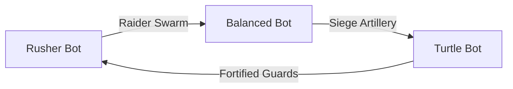

# Node War - Competitive AI Game Engine & Spectator Arena

A tournament-ready competitive strategy game engine and esports spectator visualizer designed for collegiate hackathons and coding competitions. Two student-programmed AI agents compete head-to-head on a balanced, mirrored network graph of 15 nodes.

---

## 🎮 Game Rules & Mechanics

### 1. Mirrored Network Map
- **15 Mirrored Nodes**:
  - `Node 0`: Player 1 Home Core.
  - `Node 14`: Player 2 Home Core.
  - `Node 7`: Central Relic Sanctuary.
  - Flank bastions, gates, and outposts arranged with bilateral symmetry.
- **Lanes**: Connect adjacent nodes with transit delays ($2 \dots 3$ turns).

### 2. Units & Rock-Paper-Scissors Triangle
| Unit | Cost | HP | Base ATK | Combat Affinity | Role |
| :--- | :--- | :--- | :--- | :--- | :--- |
| **Raider** | 10 | 20 | 12 | **2.0x vs Siege**, 0.5x vs Guards | Fast blitz, cheap swarm, flanker |
| **Siege** | 18 | 35 | 22 | **2.0x vs Guards**, 0.5x vs Raiders | Heavy artillery, fortified base breaker |
| **Guard** | 12 | 30 | 14 | **2.0x vs Raiders**, 0.5x vs Siege | Armored infantry, choke anchor |
| **Scout** | 6 | 10 | 0 | Non-combatant | Pierces fog of war on adjacent lanes |

### 3. Tactical Defense & Capture Progress (2-Turn Flip)
- **Defender Bonus**: Units stationed at an owned node receive a **+25% defense bonus** (damage reduction).
- **Two-Turn Flip**: When enemy defenders are wiped out, the node enters a **Contested (1/2)** state. It requires 2 consecutive turns of uncontested occupation to flip ownership. A defender's relief fleet can counter-attack on turn 1 to break the capture!
- **Recruitment Suspension**: Units cannot be trained at a contested node while enemy forces occupy it.

### 4. Economy & Empire Upkeep
- **Resource Income**: Owned nodes generate credits every turn.
- **Upkeep Cap**: Free empire unit cap = 30 units. Any active units above 30 cost **1 credit/unit/turn** in upkeep, preventing runaway snowballing.

### 5. Central Relic & Endgame Points
- **Standard Turns (1–94)**: Owned nodes award **1 point/turn**.
- **Relic Phase (Turns 95–120)**:
  - Central **Relic Sanctuary (Node 7)** activates!
  - Controlling Node 7 awards **+15 bonus points per turn**!
  - All standard node point values **double (2 points/turn)**.
- **Strict Tiebreak Formula**:
  $$\text{Score} = \text{Points} \times 10^5 + \text{Relic Turns} \times 10^3 + \text{Army Value} \times 10 + \text{Credits}$$
  Guarantees an unambiguous winner with zero draws.

---

## 🤖 Baseline Bots & Strategic Cycle

The engine ships with three baseline bots that form a rock-paper-scissors strategic dynamic:
- **RusherBot** (`bots/rusher.py`): Floods cheap Raiders immediately down the shortest corridor, overwhelming tech openings before defenses assemble.
- **TurtleBot** (`bots/turtle.py`): Rapidly anchors perimeter bastions with Guards, leveraging the +25% defense bonus and 2.0x counter multiplier to shatter early swarms.
- **BalancedBot** (`bots/balanced.py`): Deploys Scouts to survey the map and assembles heavy Siege artillery to break Turtle fortifications from distance.



---

## 🚀 Quick Start Guide

### 1. Run Baseline Tournament Matrix
Validate the strategic balance cycle across 50 matches (alternating sides):
```bash
python -m runner.tournament --rounds 25
```

### 2. Run a 1v1 Match
Simulate a match between any two bots and export the replay JSON:
```bash
python -m runner.match --p1 rusher --p2 turtle --turns 120
```

### 3. Launch Web Spectator Arena
Start the local spectator server:
```bash
python web/serve.py
```
Open **`http://localhost:8000`** in any web browser to:
- Watch live replays with timeline scrubbing and speed controls ($0.5\times \dots 5\times$).
- Toggle between **Omniscient Spectator Mode** and **Player 1/2 Fog-of-War Views**.
- Launch on-demand battles between any bots directly from the web interface.
- Inspect real-time node telemetry, garrisons, and capture meters.

---

## 👨‍💻 Writing a Custom Bot

Create a new bot in `bots/` inheriting from `BotBase` (see `bots/starter_bot.py`):
```python
from engine.models import UnitType, Order
from engine.fog import BotObservation
from bots.base import BotBase

class MyBot(BotBase):
    def act(self, obs: BotObservation) -> list[Order]:
        orders = []
        my_nodes = self.get_my_nodes(obs)
        if not my_nodes:
            return orders

        # Train units
        if obs.my_credits >= 10:
            orders.append(self.train(my_nodes[0].id, UnitType.RAIDER, 1))

        # Launch fleets
        neutrals = self.get_neutral_nodes(obs)
        if neutrals and my_nodes[0].units.get("raider", 0) >= 3:
            path = self.get_path(obs, my_nodes[0].id, neutrals[0].id)
            if len(path) >= 2:
                orders.append(self.move(my_nodes[0].id, path[1], {UnitType.RAIDER: 2}))

        return orders
```

---

## 🏆 Collegiate Event: 32-Team Bracket Scaling

For a 32-team single elimination event:
1. **Match Structure**: Best-of-3 series with alternating starting sides (P1/P2) and a randomized neutral third map.
2. **Execution Sandboxing**: `runner/match.py` enforces per-turn timeouts (e.g. 50ms) and isolates exceptions.
3. **Audience Engagement**: Spectator mode provides omniscient commentary feeds, displaying fleet ambushes before bots detect them.

