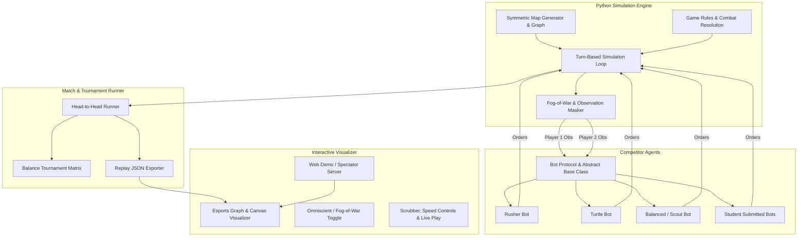

# Node War - Architecture

## System Architecture Overview

## Core Modules & Structure

1. **`engine/`**:
   - `models.py`: Data classes for Nodes, Lanes, Fleets, Combat, Upkeep, Relic, and Orders.
   - `map.py`: Symmetrical mirrored graph generator (~15 nodes, balanced paths, central relic node).
   - `combat.py`: Deterministic RPS combat resolution with defender advantage and Lanchester-style attrition.
   - `game.py`: Main state machine executing turn phases:
     1. Resource Production
     2. Upkeep Deduction
     3. Fleet Movement & ETA
     4. Scouting & Vision Resolution
     5. Combat Resolution at Nodes & Lane Collisions
     6. Two-Turn Node Capture Progress
     7. Relic Spawning (Turns $\ge T - 25$) & Point Accumulation
     8. Victory / Tiebreak Check
   - `fog.py`: Strips hidden fleet compositions from opponent observation while preserving omniscient state for spectator replays.

2. **`bots/`**:
   - `base.py`: Competitor bot interface (`act(obs) -> list[Order]`), serialization, helper navigation utilities.
   - `rusher.py`: Aggressive Raider swarm targeting adjacent economy nodes early.
   - `turtle.py`: Heavy Guard defense, chokepoint consolidation, tech/economy buildup.
   - `balanced.py`: Recon-first strategy deploying scouts, reading enemy fleets, and recruiting counter-units (Siege against Guards, Guards against Raiders, Raiders against Siege).

3. **`runner/`**:
   - `match.py`: Head-to-head match executor, per-turn time limits, exception isolation.
   - `tournament.py`: Automated round-robin matrix testing win-rates to verify RPS balance cycle.
   - `replay.py`: Compact, structured JSON replay serialization.

4. **`web/`**:
   - Web-based spectator frontend displaying interactive nodes, glowing lanes, traveling fleet badges, combat clash animations, spectator vs player view toggle, timeline scrubber, and real-time scoreboard.
